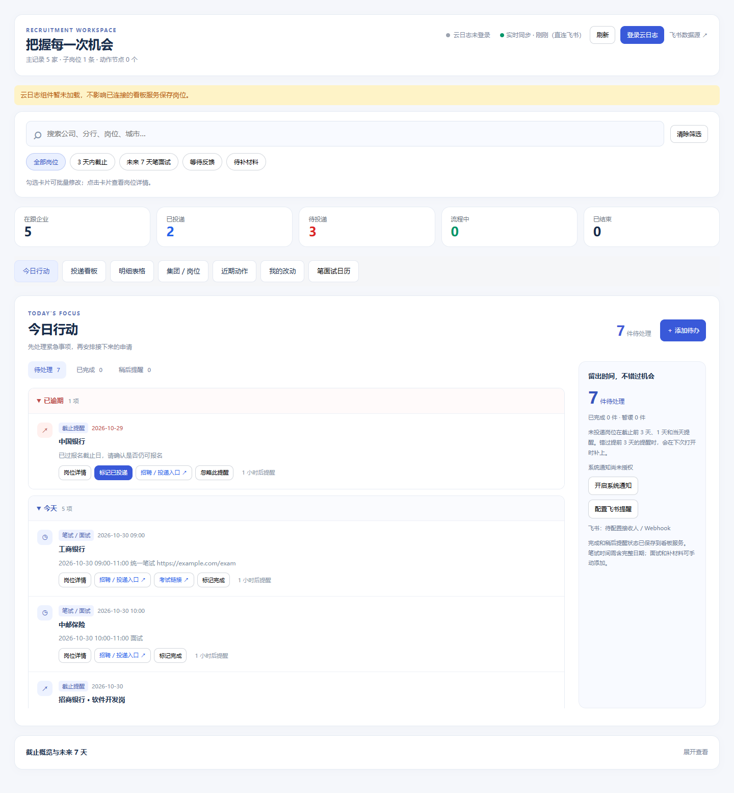
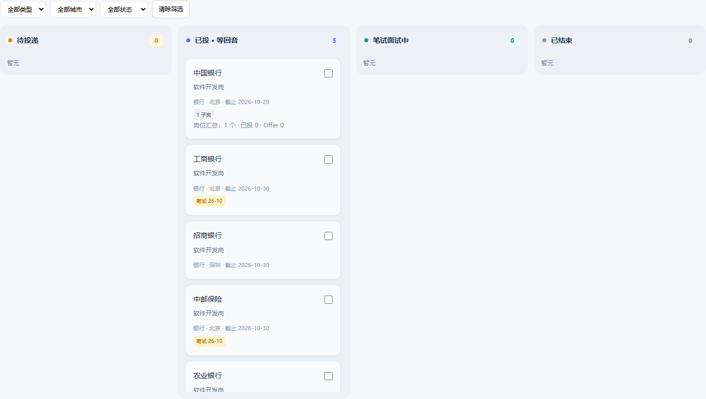
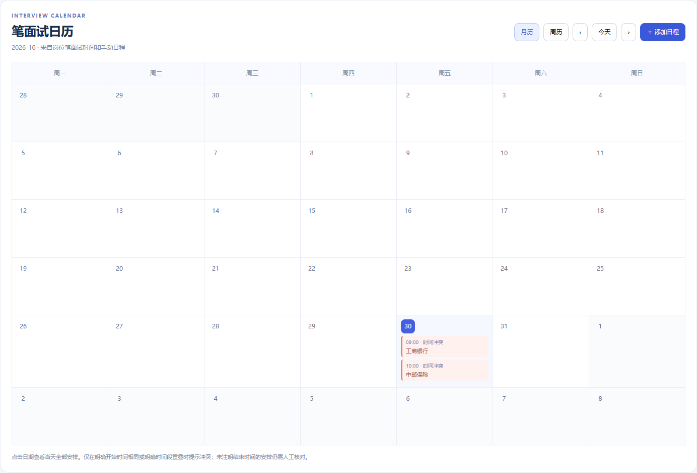
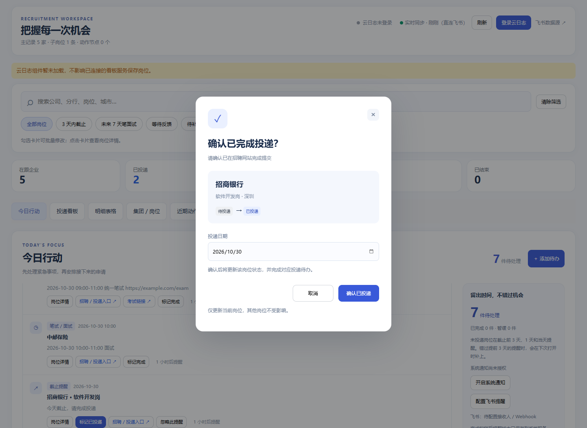
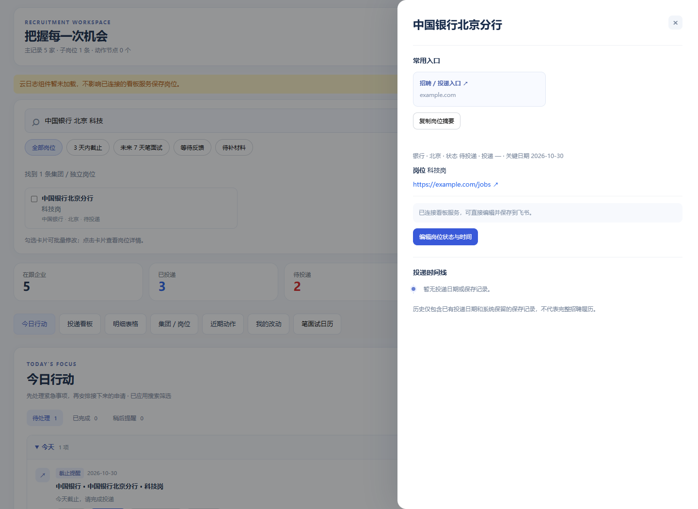

<div align="center">

# 校招进度看板 · Recruit Board

### 把投递进度、笔面试安排和下一步行动，放在同一个地方。

从「投了哪些公司」到「今天先做什么」。<br>
一个以飞书多维表格为数据源的个人求职工作台。

**今日行动 · 独立岗位 · 笔面试日历 · 飞书同步**

[页面预览](#页面预览) · [功能一览](#功能一览) · [快速体验](#快速体验) · [接入飞书](#接入飞书) · [参与改进](#参与改进)

</div>



> 适合同步推进多家公司、分行和岗位的秋招／春招求职者。截图使用测试记录与示例链接，不代表真实招聘信息或企业合作。

## 不只是记录，还能推动下一步

- **打开就知道先做什么。** 已逾期、今天、未来 3 天分组展示，完成和稍后提醒分别管理。
- **每个岗位都有自己的进度。** 同一集团下的不同分行、岗位独立记录，集团负责汇总。
- **从提醒直接进入行动。** 打开投递入口、查看考试链接、确认已投递，不用反复翻找备注。
- **保存有反馈，历史能回看。** 异步保存、失败重试，以及按字段展示的改动记录。

## 页面预览

### 投递看板：扫一眼，知道申请走到哪一步

四列组织待投递、等待反馈、笔面试中和已结束的申请。卡片集中显示岗位、城市、截止时间和进展标签；支持勾选后批量修改。



### 笔面试日历：把时间安排放到一起

支持月历／周历、当天安排、手动添加日程和岗位详情跳转。明确时间相同或明确时间段重叠时提示冲突。



<details>
<summary><strong>展开查看：投递确认与岗位详情侧栏</strong></summary>

#### 确认后再更新，避免误触

点击「标记已投递」先确认公司、岗位和投递日期。取消不会修改数据，确认只更新当前岗位。



#### 保留浏览位置，随手查看岗位信息

右侧栏集中展示招聘入口、岗位信息、子岗位、投递日期和已保留的操作历史；支持复制岗位摘要。



</details>

## 功能一览

| 功能 | 可以做什么 |
| --- | --- |
| 今日行动 | 汇总截止提醒、笔面试、待补材料和手动待办；完成、撤销、稍后提醒 |
| 全局搜索 | 搜公司、集团、分行、岗位、城市，支持多关键词，记住当前浏览器的搜索条件 |
| 快捷筛选 | 3 天内截止、未来 7 天笔面试、等待反馈、待补材料 |
| 独立岗位 | 按记录保存状态、投递日期、截止日与笔面试时间，集团汇总子岗位 |
| 笔面试日历 | 月／周切换、日期展开、手动日程编辑、明确时间冲突提示 |
| 批量操作 | 修改状态、日期，追加或替换进展；部分失败单独显示和重试 |
| 常用入口 | 提取已有招聘／投递、考试和材料链接，子岗位可使用集团招聘入口 |
| 改动记录 | 新记录按字段显示修改前后值；旧日志明确标注旧值未记录 |
| 保存反馈 | 后台提交、失败恢复与重试；成功提示自动收起，警告与失败保留 |
| 提醒 | 截止前 3 天、1 天和当天提醒；可选浏览器通知、飞书机器人通知 |
| 响应式布局 | 桌面侧栏与手机全宽详情，日历在自身区域横向滚动 |

## 快速体验

需要 Python 3。先用仓库自带示例生成只读页面，无需飞书账号或应用凭证：

```bash
git clone https://github.com/dong-design/Recruitment-Board.git
cd Recruitment-Board
python scripts/build-demo.py
python -m http.server 8000 --bind 127.0.0.1 -d dashboard
```

浏览器打开 **http://127.0.0.1:8000**。

示例页面用于体验布局、搜索、看板和详情；保存、任务持久化、通知发送需要运行后端。示例日期固定，今日事项数量会随日期变化。`build-demo.py` 会重新生成 `dashboard/index.html`，不会读取个人飞书配置。

## 接入飞书

### 1. 准备多维表格

字段名称需与下表一致。不同岗位请建立独立记录，再通过「父记录」关联到集团。

| 字段 | 类型 | 用途 |
| --- | --- | --- |
| 公司名称 | 文本 | 公司／分行／子岗位名称 |
| 单位类型 | 单选 | 银行、央企国企、互联网等 |
| 城市 | 多选 | 工作地点 |
| 岗位 | 文本 | 岗位名称 |
| 投递 | 单选 | `待投递`、`已投递`、`已截止`、`挂了`、`Offer`、`实习offer` |
| 进展 | 多选 | `ai面`、`测评`、`笔试`、`一面`、`二面`、`三面`、`体检` |
| 投递日期 | 日期 | 实际投递日期 |
| 报名截止日 | 日期 | 截止提醒依据 |
| 最新日期 | 日期 | 无截止日时展示的参考日期，不当作截止日 |
| 笔试时间 | 文本 | 完整日期与时间，如 `2026-11-01 14:00-16:00 面试` |
| 备注 | 文本 | 材料要求、说明及相关链接 |
| 链接 | 文本 | 招聘／投递入口 |
| 父记录 | 关联本表 | 关联集团，不填则为主记录 |

### 2. 配置服务端

需要 Node.js 18+。在飞书开放平台创建应用，配置所需多维表格读写权限，并授予目标表访问权限。将以下文件保存在 **`dashboard/.feishu-app.json`**：

```json
{
  "app_id": "你的 App ID",
  "app_secret": "你的 App Secret",
  "app_token": "目标多维表格的 app_token",
  "table_id": "目标表的 table_id"
}
```

创建本地看板账号：

```bash
node scripts/setup-auth.js
```

启动前显式设置 `BOARD_AUTH=on`、`HOST=127.0.0.1`，再运行：

```bash
node dashboard/server.js
```

Windows PowerShell 设置环境变量的方式：

```powershell
$env:BOARD_AUTH = "on"
$env:HOST = "127.0.0.1"
node dashboard/server.js
```

默认访问 **http://127.0.0.1:3000**，使用本地 `.board-auth.json` 中的账号登录。后端通过 `/api/pull` 读取飞书，通过 `/api/sync` 保存修改。云日志登录是可选的独立通道，不是直连飞书保存的前提。

生成器中的 `SRC`、`FEISHU_URL`、`ACTIONS` 和 `CLOUD_CONFIG` 控制静态快照及可选云集成；使用自己的快照时请核对这些配置，不要沿用他人的应用地址。示例构建脚本会覆盖这些值，确保演示使用示例数据。

### 3. 部署与提醒

| 模式 | 适合用途 | 运行要求 |
| --- | --- | --- |
| 静态页面 | 只读展示、公开示例 | 发布生成的 HTML；公开前确认仅含示例数据 |
| Node 服务 | 真实数据、保存、任务状态与本地日志 | 服务端飞书配置、访问控制、持久化存储 |
| 浏览器通知 | 页面打开时的系统提醒 | 用户授权通知，页面保持运行 |
| 飞书提醒 | 后台检查并发送消息 | 配置机器人／接收人，Node 服务持续运行且可联网 |

云端部署请显式配置鉴权及 HTTPS 网关，不要只依赖默认值。当前代码在设置 `PORT` 时可能关闭内置认证，需检查 `BOARD_AUTH` 与网关保护。持久化并备份 `dashboard/.planner-state.json` 和通知配置，避免重建实例后丢失待办与提醒状态。

## 使用边界

- 保存耗时取决于网络和飞书接口；界面异步响应不等于上游已保存，请以结果提示为准。
- 日历需要完整日期；时间未明确时不会推断考试时段。时间线只展示已有字段和保留的记录，不补造历史。
- 批量保存逐条执行，可能部分成功；超时后建议先核对结果再重试。
- 浏览器关闭后不继续发送系统通知；飞书提醒需要后台服务运行。
- 可选 WorkBuddy 云登录取决于平台认证配置，配置凭证不代表身份校验一定通过。

## 隐私与数据

**不要公开真实求职快照或服务端凭证。** 生成的 HTML 会内嵌岗位、备注和链接。截图展示也请使用示例记录。

以下文件已加入忽略规则，提交前仍建议检查 `git status --short`：

- `feishu_records.ndjson`、`dashboard/index.html`：个人数据及生成快照。
- `.env`、`dashboard/.feishu-app.json`：服务端凭证。
- `dashboard/.board-auth.json`：看板账号。
- `dashboard/.planner-state.json`、`dashboard/.notifications.json`：待办、日志及提醒配置。

## 开发与测试

前端使用原生 JavaScript / CSS，Python 负责生成页面，Node.js 提供服务端接口。

```text
dashboard/
  workspace.js          今日行动、搜索、日历、侧栏与批量操作
  workspace-engine.js   搜索匹配、日期解析、冲突检测
  workspace.css         工作台样式
  planner.js            待办与异步保存
  planner-store.js      状态和操作记录持久化
  notifier.js           飞书提醒
  server.js             飞书读写与看板 API
scripts/build-demo.py    安全构建只读示例
sample/                 示例数据
tests/                  回归测试
```

在仓库根目录运行：

```bash
python scripts/build-demo.py
python tests/test_generator.py
node --test tests/*.test.js
```

自动测试使用模拟上游，不修改真实求职记录。界面截图使用测试数据；不能作为生产同步或消息送达的证明。

## 参与改进

欢迎通过 [Issues](https://github.com/dong-design/Recruitment-Board/issues) 反馈使用问题与功能建议，或提交 Pull Request。反馈时请附复现步骤和脱敏截图，不要附密码、令牌或完整个人数据。

如果这个项目帮你理清了投递节奏，欢迎点一个 **Star**，让更多求职者找到它。

## License

[MIT](LICENSE)
